<div align="center">

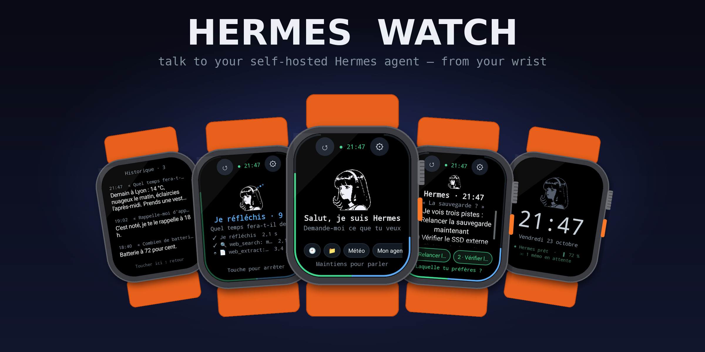

# Hermes Watch

**Hold the screen. Speak. Your own Hermes answers — out loud, on your wrist.**

A voice-first Android app that turns a cheap Android smartwatch into a
[Hermes Gadget](https://github.com/Adolanium/hermes-gadget-sdk): a pocket terminal for the
self-hosted [Hermes Agent](https://hermes-agent.nousresearch.com) running at home.


[**⬇ Download the APK**](apk/hermes-montre.apk) · [Screens](#a-tour-of-the-screens) ·
[Features](#what-it-does) · [Install](#install-in-five-minutes) · [How it works](#how-it-works)

</div>

---

## Why

Phones are for scrolling. Your agent deserves a **button on your wrist**.

Hermes Watch is built for the cheap "Ultra" Android watches (tested design target: the
*Ultra I3 AI*, Android 11, AMOLED with very rounded corners): no Wear OS, no Google account, no
cloud. The watch talks to **your** machine over **your** Wi-Fi; speech-to-text, the model and
the voice all run where Hermes already runs.

> The UI speaks **French** for now — every screenshot below is the real app.

---

## A tour of the screens

Every image is rendered **from the app's real code** (layout + drawing), at the exact scale the
watch uses, then framed in a case. Nothing is mocked up by hand.

<table>
<tr>
<td align="center" width="33%">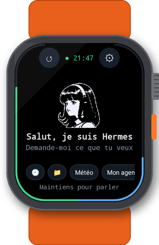<br>
<b>Idle</b><br><sub>The Hermes mascot breathes and blinks. Battery runs up the left edge, your Claude quota up the right. Shortcuts: 🕘 history, 📁 projects, favourite questions.</sub></td>
<td align="center" width="33%">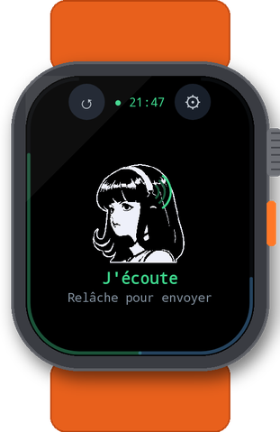<br>
<b>Listening</b><br><sub>Hold anywhere on the mascot. Green waves leave her headphones and grow with your voice. Release to send.</sub></td>
<td align="center" width="33%">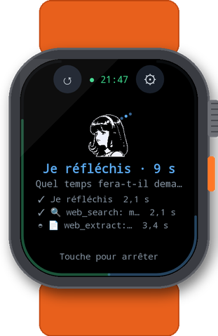<br>
<b>Thinking — live</b><br><sub>Every step as it happens: transcription, reasoning, each tool with its emoji and timing (🔍 web_search, 📄 web_extract…), then writing.</sub></td>
</tr>
<tr>
<td align="center">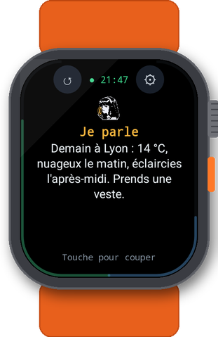<br>
<b>Speaking</b><br><sub>Her mouth moves, orange waves leave it, and the answer is spoken through the watch speaker — in the very voice Hermes uses everywhere else (GPU voices included).</sub></td>
<td align="center">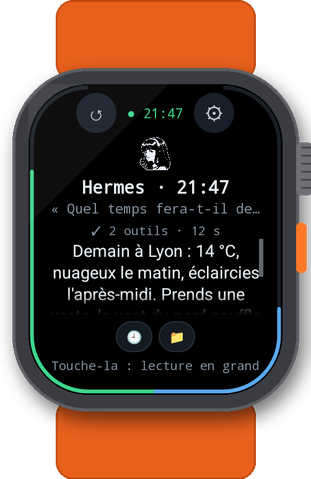<br>
<b>The answer</b><br><sub>Time of the reply, what was heard, a one-line summary (“✓ 2 tools · 12 s”). Tap to read it big.</sub></td>
<td align="center">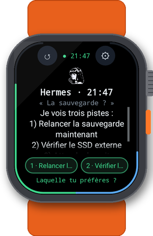<br>
<b>Answer with a tap</b><br><sub>When Hermes offers options (“1) … 2) … Which one?”) or asks a yes/no question, they become green buttons. Tap = say it.</sub></td>
</tr>
<tr>
<td align="center">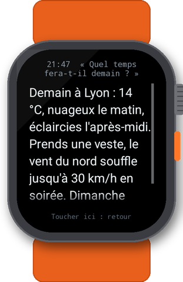<br>
<b>Reading mode</b><br><sub>Big type, scroll with the <b>crown</b> or a finger. The offered choices follow the text as full-width buttons.</sub></td>
<td align="center">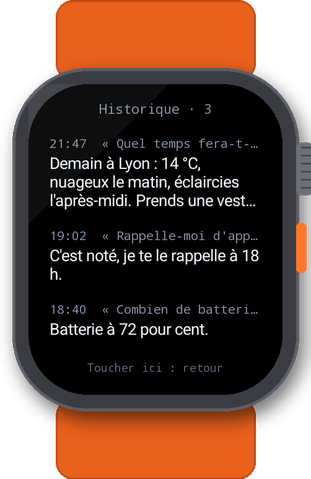<br>
<b>History</b><br><sub>The last 20 exchanges — kept in memory only, never written to the watch.</sub></td>
<td align="center">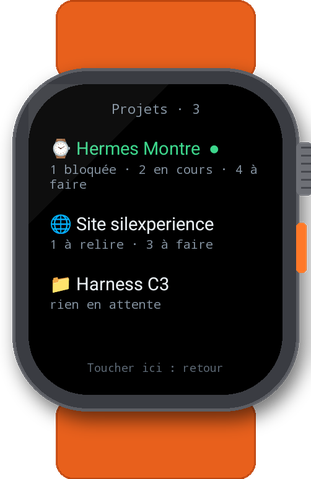<br>
<b>Projects</b><br><sub>Hermes' own projects (<code>hermes projects</code>), the active one marked ●, with what is waiting: blocked, running, to do.</sub></td>
</tr>
<tr>
<td align="center">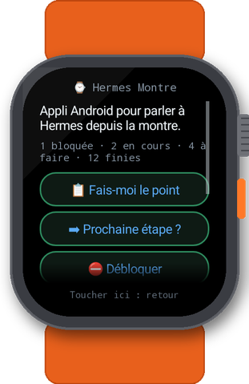<br>
<b>A project</b><br><sub>Description, open kanban tasks (blocked first, in red) and one-tap actions: <i>give me the status</i>, <i>next step?</i>, <i>unblock</i>, <i>work on this</i>.</sub></td>
<td align="center">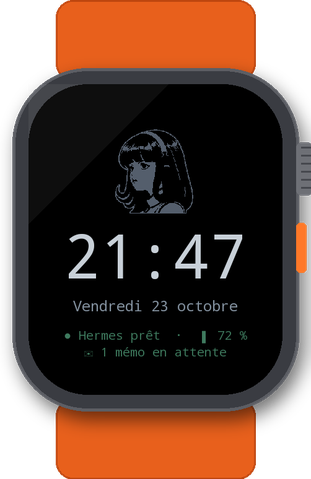<br>
<b>Watch face</b><br><sub>After 30 s of calm: big clock, date, Hermes state, battery; dimmed. One touch wakes it without talking to Hermes.</sub></td>
<td align="center">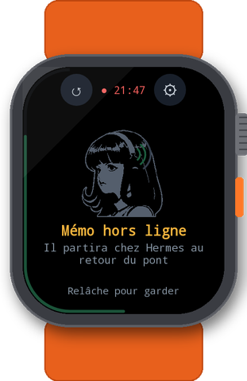<br>
<b>Offline memo</b><br><sub>No Wi-Fi, no bridge? Talk anyway. The memo waits on the watch and is sent the moment the bridge is back.</sub></td>
</tr>
<tr>
<td align="center">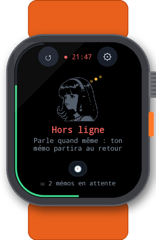<br>
<b>Offline</b><br><sub>Clear state, pending memos, and the watch looks for the bridge on its own.</sub></td>
<td align="center">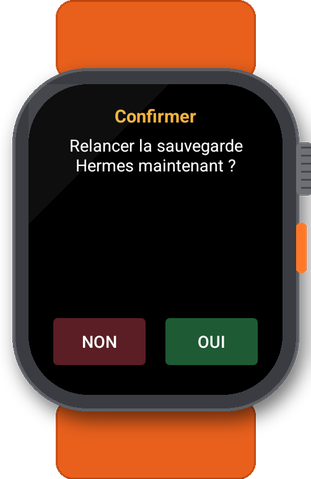<br>
<b>Confirmations</b><br><sub>Sensitive actions (money, deleting, the system) are confirmed before anything runs.</sub></td>
<td align="center">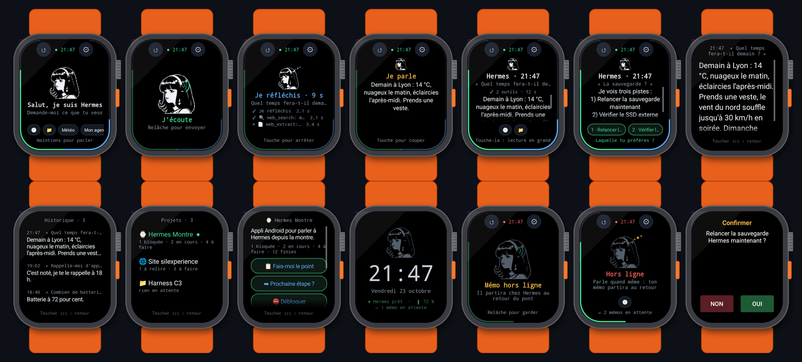<br>
<b>All of them</b><br><sub><a href="docs/all-screens.png">Open the full contact sheet</a>.</sub></td>
</tr>
</table>

---

## What it does

### Talk
- **Hold to talk**, release to send — or *tap mode*: tap once, it stops when you stop talking.
- **Push-to-talk only.** The microphone is never on in the background, never longer than 30 s,
  and always visibly on (green “J'écoute”).
- **Interrupt** at any time: touch the mascot while Hermes thinks or speaks.
- **Wake-to-talk** (option): turn the screen back on and the mic is already open.
- **Shake-to-talk** (option), the watch **assistant button**, or a headset button.

### See what Hermes is doing
- **Live steps** straight from Hermes' API stream (`hermes.tool.progress`, `reasoning_content`):
  each tool, its emoji, its duration; the reasoning; the writing.
- **The clock**, always, at the top; the elapsed time while it works; the time of each answer.

### Answer without speaking
- **Choices become buttons** — numbered lists, bullet lists ending in a question, closed questions
  (“Shall I restart it?” → *Yes / No / Later*), the bridge's suggestions and ideas.
- **Favourite questions** one tap away (configurable).

### Explore your projects
- Hermes' **projects** and their **kanban tasks**, read-only, with one-tap actions that become real
  requests to Hermes (whose answers come back with… tappable choices).

### Built for the wrist
- **Pure black** UI: on AMOLED a black pixel is off — the app melts into the bezel and saves battery.
- **Nothing in the corners** (they are very rounded on these watches); the edges carry two gauges
  that follow the curve: **battery** (left) and **Claude quota** (right).
- **Same layout on every watch**: Chinese watches report wildly different screen densities; the
  app rescales itself so the short side is always 240 dp.
- **Crown scrolling** (rotary input or D-pad keys, depending on the watch).
- **Haptic language** — you know what happened without looking:

  | Pattern | Meaning |
  |---|---|
  | `▁` one tick | mic open |
  | `▁ ▁` two light ticks | sent to Hermes |
  | `▂▁▂` short-long-short | answer arrived |
  | `▂ ▂ ▂` three equal | yes/no question |
  | `███ ███` two long | urgent alert |
  | `████` one long | something failed |

### Let Hermes use the watch
The watch exposes **actions** Hermes can call, and **sensors** it can read:

| Actions | Sensors (only those the watch has) |
|---|---|
| `speaker.volume`, `screen.brightness`, `haptic.vibrate`, `timer.set`, `torch.set`, `sensors.read` | battery (%, mV, charging, temperature), heart rate, steps, ambient light, air pressure |

“Turn the volume up”, “buzz me in 10 minutes”, “how's my battery?” — all just work.

### Stay up to date by itself
The watch asks the bridge for a newer version at start-up and every 6 h, downloads it over your
LAN, checks its **SHA-256**, and offers *Install / Later*. Android refuses any APK signed with
another key.

The bridge serves the update from a clone of **this repository** next to `hermes-voice`, so
publishing a version to every watch in the house is one command on the PC:

```sh
git clone https://github.com/Silexperience210/hermes-watch ~/hermes-watch   # once
cd ~/hermes-watch && git pull                                              # each release
```

(Releasing from source: bump `versionCode`/`versionName` in `app/build.gradle.kts`, then
`./gradlew assembleRelease && python3 tools/publish.py "what changed"` and push.)

---

## How it works

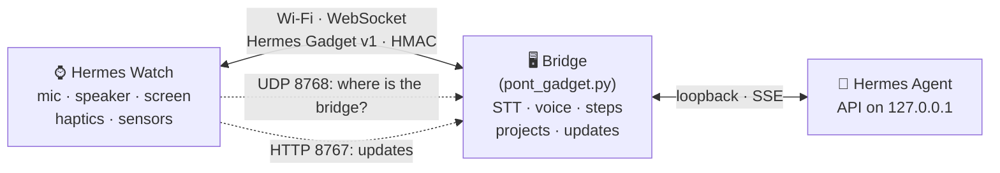

- **Protocol:** the watch is a regular [Hermes Gadget protocol v1](https://github.com/Adolanium/hermes-gadget-sdk/blob/main/docs/protocol.md)
  device — a 32-byte device key generated on first launch, a device id derived from it
  (`hg-` + SHA-256), key on first contact then **HMAC-SHA256** challenge on every connection,
  PCM16 16 kHz audio frames of 40 ms. The test suite pins the SDK's own vectors.
- **Two ways to connect:**

  | | Official Hermes Gadget plugin | The `hermes-voice` bridge |
  |---|:---:|:---:|
  | Talk, voice answers, cards, yes/no prompts, actions, sensors | ✓ | ✓ |
  | Choices parsed from Hermes' answers | ✓ | ✓ |
  | Live tool steps, choices for suggestions/ideas | — | ✓ |
  | Projects explorer, Claude quota on the edge | — | ✓ |
  | Auto-discovery, auto-update over LAN | — | ✓ |
  | Hermes' own configured voice (GPU), Piper fallback | — | ✓ |

  Unknown message types are ignored by design, so the extras never break a plain plugin.

---

## Install in five minutes

1. **Put the APK on the watch** — open [`apk/hermes-montre.apk`](apk/hermes-montre.apk) in the
   watch's browser, or with a cable:
   ```sh
   adb install -r hermes-montre.apk
   ```
   (*Settings › About* → tap *Build number* 7 times → *Developer options* → *USB debugging*.)
2. **Run the bridge** on the machine where Hermes lives (or enable the Hermes Gadget plugin),
   and clone this repository next to it so the bridge can serve updates:
   `git clone https://github.com/Silexperience210/hermes-watch ~/hermes-watch`.
   Open the ports if a firewall is on:
   ```sh
   sudo ufw allow 8765/tcp && sudo ufw allow 8767/tcp && sudo ufw allow 8768/udp
   ```
3. **Open Hermes on the watch**, allow the microphone. It **finds the bridge by itself**
   (or ⚙ › *Trouver le pont tout seul*, or type `ws://<pc-ip>:8765/gadget`).
4. **Approve the watch once** — it shows its id; on the PC:
   ```sh
   bash ~/hermes-voice/outils/approuver.sh hg-xxxxxxxxxxxxxxxx      # bridge
   hermes pairing approve gadget <CODE>                              # official plugin
   ```
5. The dot turns green. **Hold the mascot and talk.**

<details>
<summary><b>Troubleshooting</b></summary>

| The watch shows | Likely cause |
|---|---|
| *Hors ligne* | bridge not running, other Wi-Fi network, firewall (ports above) |
| *Refusé — clé* | the app was reinstalled (new key): forget the old device on the PC and approve again |
| *Refusé — jeton* | the bridge runs with an access token: type it in ⚙ |
| No sound | raise the watch's **media** volume, or say “volume à 80” |
| Drops when the screen is off | *Settings › Battery*: don't optimise **Hermes** |
| Text tiny / huge | should not happen anymore (auto-scaling) — please open an issue with a photo |

</details>

---

## Privacy & security

- **Your network only.** The watch talks to your bridge; the bridge talks to Hermes on loopback.
- **Push-to-talk.** No wake word, no background listening, 30 s max, always visible.
- **Nothing kept on the watch** except settings, the device key, and offline memos until they are
  sent (app-private storage). History lives in memory and is gone when the app stops.
- **Authenticated device:** HMAC challenge on every connection; unknown devices wait for approval.
- **Read-only** access to Hermes' projects and kanban; the only change (*work on this*) goes
  through Hermes' own `hermes projects use`.
- **Updates** are verified by SHA-256 and by Android's signature check.

---

## Build from source

```sh
./gradlew testDebugUnitTest assembleRelease     # JDK 17+, Android SDK platform 34
# → app/build/outputs/apk/release/app-release.apk
```

**Signing.** The signing key is **never** in this repository. Put it next to the project in
`keystore.properties` (ignored by git):

```properties
storeFile=hermes-watch.jks
storePassword=…
keyAlias=hermes-watch
keyPassword=…
```

or provide `HERMES_WATCH_KEYSTORE`, `HERMES_WATCH_KEYSTORE_PASSWORD`, `HERMES_WATCH_KEY_ALIAS`
(e.g. as CI secrets). Without it, the release build is signed with the debug key: it installs,
but cannot update a watch that runs a build signed with the real key.

| Test suite | What it proves |
|---|---|
| `ProtocoleTest` | device id and HMAC match the Hermes Gadget SDK's own vectors |
| `ServeurReelTest` | the real client against the real SDK hub: enrol, HMAC reconnect, a typed turn and a spoken turn (`HG_URL=…`) |
| `EtapesTest`, `PropositionsTest` | live steps and tappable choices extraction |
| `MiseAJourTest`, `MiseAJourReelleTest` | update metadata, SHA-256, download from the real bridge server (`HG_MAJ_URL=…`) |
| `DecouverteTest` | finding the bridge over UDP against the real beacon (`HG_PHARE=1`) |
| `CapturesTest` | the 14 screens above, rendered by Paparazzi: `./gradlew recordPaparazziDebug` |

<details>
<summary><b>Source map</b></summary>

| File | Role |
|---|---|
| `GadgetClient.kt`, `Protocole.kt`, `Identite.kt` | Hermes Gadget v1 client: handshake, HMAC, frames, reconnection |
| `HermesService.kt` | foreground service: connection, mic, speaker, sensors, turns, memos, updates |
| `Micro.kt`, `HautParleur.kt`, `VoixMontre.kt` | 16 kHz capture with silence detection, streamed playback, optional on-watch TTS |
| `EcranPrincipal.kt`, `MascotteView.kt`, `BordView.kt` | the screen, the animated mascot, the edge gauges |
| `Etapes.kt`, `Propositions.kt` | live steps; choices found in answers |
| `Decouverte.kt`, `MiseAJour.kt`, `Memos.kt`, `Echelle.kt` | discovery, self-update, offline memos, density normalisation |
| `Actions.kt`, `Capteurs.kt` | what Hermes can do on the watch, what it can read |

</details>

---

## Roadmap

- English UI (strings are French today)
- Complications for the system watch face
- Opus audio to the watch (the protocol already supports it)
- Image cards (`image.start`) on the watch screen

---

## Credits

- **Hermes Agent** by [Nous Research](https://nousresearch.com) — the brain.
- **The mascot** — Hermes Agent's “girl with the headphones”, MIT, © 2025 Nous Research, via the
  Hermes Gadget SDK. Used because this is a Hermes project; see [NOTICE](NOTICE).
- **Hermes Gadget SDK** — the device protocol this app implements.

This project is **unofficial** and not affiliated with Nous Research. MIT licensed — see [LICENSE](LICENSE).
